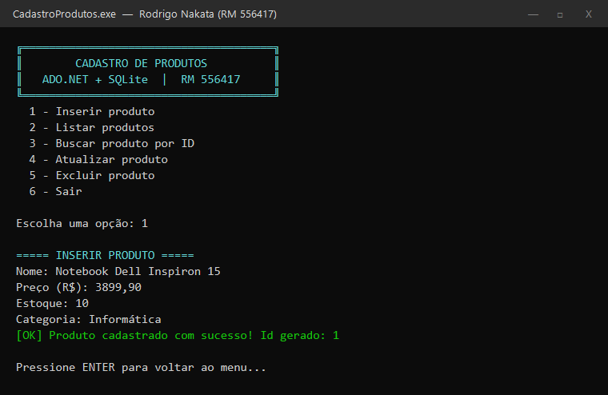
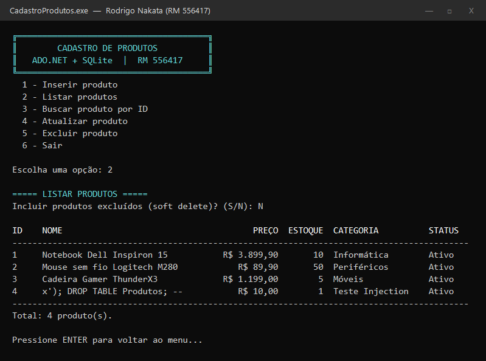
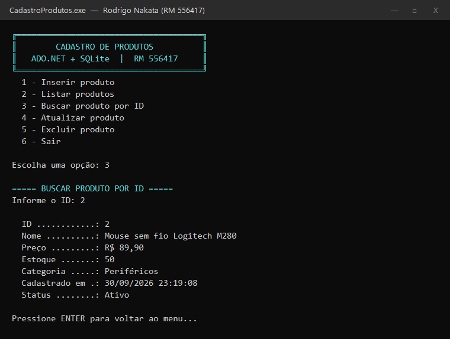
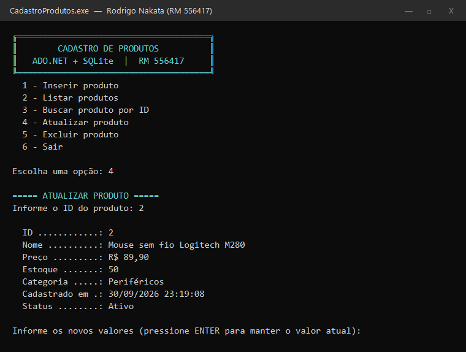
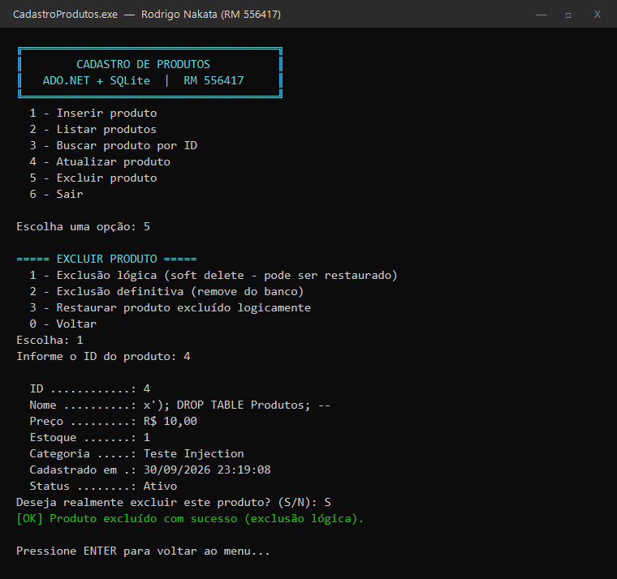
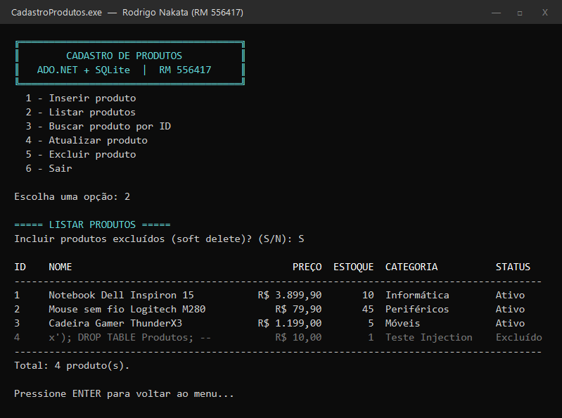
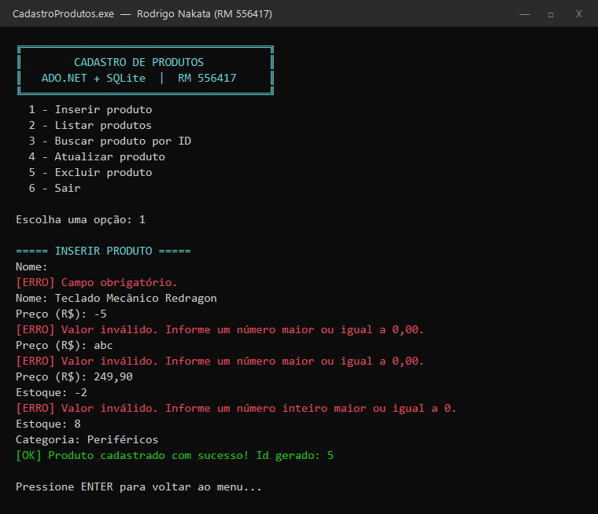
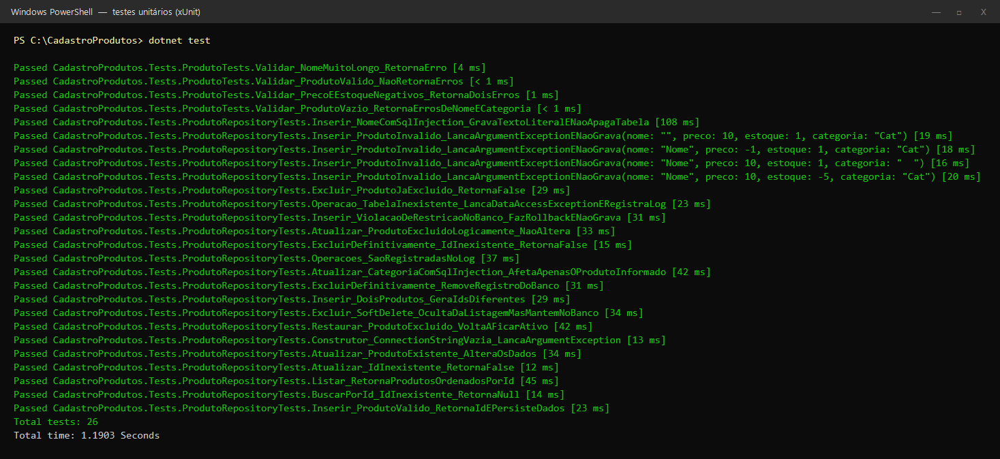
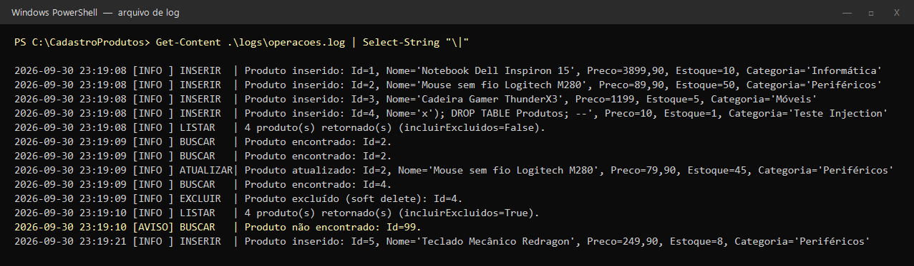

# Cadastro de Produtos — C# + ADO.NET

Aplicação de console em **C# (.NET 8)** para cadastrar e gerenciar produtos, usando **ADO.NET puro**
(`Microsoft.Data.Sqlite`) para acessar um banco **SQLite**.

| | |
|---|---|
| **Aluno** | Rodrigo Nakata |
| **RM** | 556417 |
| **Banco** | SQLite (arquivo `produtos.db`, criado automaticamente) |
| **Tecnologias** | C# 12, .NET 8, ADO.NET (`Microsoft.Data.Sqlite`), `Microsoft.Extensions.Configuration.Json`, xUnit |

---

## Funcionalidades

Menu principal:

```
1 - Inserir produto
2 - Listar produtos
3 - Buscar produto por ID
4 - Atualizar produto
5 - Excluir produto
6 - Sair
```

- **CRUD completo**: `Inserir`, `Listar`, `BuscarPorId`, `Atualizar` e `Excluir`.
- **SQL parametrizado** em **todas** as operações (`@Nome`, `@Preco`, `@Id`, ...). Nenhum valor digitado pelo usuário é concatenado no SQL.
- **`ExecuteNonQuery`** nas operações de INSERT, UPDATE e DELETE; **`ExecuteReader`** nas consultas SELECT.
- **Mapeamento manual** do `SqliteDataReader` para objetos `Produto` (método `MapearProduto`).
- **Tratamento de exceções**: `SqliteException` é capturada no Repository, registrada no log e convertida em `DataAccessException` com mensagem amigável, de acordo com o código de erro do SQLite (restrição violada, banco bloqueado, arquivo inacessível, tabela inexistente…).
- **Log em arquivo** (`logs/operacoes.log`) de todas as operações: inserções, listagens, buscas, atualizações, exclusões, avisos e erros.
- **Validação de entrada** no console (campos obrigatórios, preço/estoque não negativos, limites de tamanho) e no modelo (`Produto.Validar()`), além de `CHECK constraints` no banco.

### Bônus implementados

| Bônus | Onde |
|---|---|
| ✅ **Soft delete** | `Excluir` marca `Ativo = 0` e preenche `DataExclusao`. A listagem pode incluir ou ocultar os excluídos, e é possível **restaurar** o produto. Há também a exclusão definitiva (`DELETE`). |
| ✅ **Transações** | Todas as operações de escrita usam `BeginTransaction()` + `Commit()` / `Rollback()`. No `Inserir`, o INSERT e a leitura do Id gerado (`last_insert_rowid()`) acontecem na mesma transação. |
| ✅ **Testes unitários** | 26 testes xUnit (`tests/CadastroProdutos.Tests`) cobrindo o CRUD, SQL Injection, soft delete, rollback, tratamento de erros e log. |

---

## Estrutura do projeto

```
CadastroProdutos/
├── database/
│   └── script.sql                 # Script de criação da tabela Produtos
├── docs/
│   ├── prints/                    # Prints das operações funcionando
│   └── ROTEIRO_APRESENTACAO.md    # Roteiro do vídeo (3 a 5 min)
├── src/CadastroProdutos/
│   ├── appsettings.json           # Connection string e caminhos de script/log
│   ├── Program.cs                 # Ponto de entrada: lê config, cria o banco e monta as camadas
│   ├── Models/
│   │   └── Produto.cs             # Entidade + validação
│   ├── Data/
│   │   ├── ProdutoRepository.cs   # TODO o acesso ao banco (ADO.NET)
│   │   ├── DatabaseInitializer.cs # Executa o script.sql na inicialização
│   │   └── DataAccessException.cs # Exceção amigável da camada de dados
│   ├── Logging/
│   │   ├── IOperacaoLogger.cs
│   │   └── FileLogger.cs          # Grava o log em arquivo
│   └── UI/
│       ├── MenuProdutos.cs        # Interface: menu e telas (sem SQL)
│       └── ConsoleHelper.cs       # Leitura/validação de entrada e mensagens coloridas
├── tests/CadastroProdutos.Tests/  # Testes unitários (xUnit)
└── CadastroProdutos.sln
```

**Separação de responsabilidades:**

```
 MenuProdutos (UI)  ──►  ProdutoRepository (Dados)  ──►  SQLite
   só conversa com         só executa SQL
   o usuário               parametrizado
```

A camada de interface **não tem nenhum comando SQL**, e o Repository **não lê nem escreve no console**.

---

## Como configurar e executar

### Pré-requisitos

- [.NET SDK 8.0](https://dotnet.microsoft.com/download/dotnet/8.0) ou superior.
  Verifique com `dotnet --version`.
- Não é preciso instalar nenhum servidor de banco: o SQLite já vem no pacote NuGet `Microsoft.Data.Sqlite`.

### 1. Clonar o repositório

```bash
git clone <URL-DO-REPOSITORIO>
cd CadastroProdutos
```

### 2. (Opcional) Ajustar a connection string

Arquivo `src/CadastroProdutos/appsettings.json`:

```json
{
  "ConnectionStrings": {
    "DefaultConnection": "Data Source=produtos.db"
  },
  "Database": {
    "ScriptPath": "database/script.sql"
  },
  "Logging": {
    "FilePath": "logs/operacoes.log"
  }
}
```

Caminhos relativos são resolvidos a partir da pasta do executável
(`src/CadastroProdutos/bin/Debug/net8.0/`). Para usar outro local, informe um caminho absoluto,
por exemplo `"Data Source=C:\\dados\\produtos.db"`.

### 3. Executar a aplicação

```bash
dotnet run --project src/CadastroProdutos
```

Na primeira execução, a aplicação roda o `database/script.sql` e cria o arquivo `produtos.db` com a
tabela `Produtos`. O script usa `CREATE TABLE IF NOT EXISTS`, então pode ser executado várias vezes sem problema.

> Se preferir, crie o banco manualmente com o [sqlite3](https://sqlite.org/download.html):
> `sqlite3 produtos.db < database/script.sql`

### 4. Executar os testes

```bash
dotnet test
```

### 5. Consultar o log

Depois de usar a aplicação, abra:

```
src/CadastroProdutos/bin/Debug/net8.0/logs/operacoes.log
```

---

## Script SQL (`database/script.sql`)

```sql
CREATE TABLE IF NOT EXISTS Produtos (
    Id            INTEGER        PRIMARY KEY AUTOINCREMENT,
    Nome          TEXT           NOT NULL CHECK (length(trim(Nome)) > 0 AND length(Nome) <= 100),
    Preco         NUMERIC(10,2)  NOT NULL CHECK (Preco >= 0),
    Estoque       INTEGER        NOT NULL DEFAULT 0 CHECK (Estoque >= 0),
    Categoria     TEXT           NOT NULL CHECK (length(trim(Categoria)) > 0 AND length(Categoria) <= 50),

    -- Colunas de controle para o SOFT DELETE (bônus)
    Ativo         INTEGER        NOT NULL DEFAULT 1 CHECK (Ativo IN (0, 1)),
    DataCadastro  TEXT           NOT NULL DEFAULT (datetime('now', 'localtime')),
    DataExclusao  TEXT           NULL
);
```

---

## Como o código evita SQL Injection

Todo valor vindo do usuário entra no comando como **parâmetro**, nunca concatenado na string SQL:

```csharp
const string sql = @"
    INSERT INTO Produtos (Nome, Preco, Estoque, Categoria)
    VALUES (@Nome, @Preco, @Estoque, @Categoria);";

comando.CommandText = sql;
comando.Parameters.Add("@Nome", SqliteType.Text).Value = produto.Nome.Trim();
comando.Parameters.Add("@Preco", SqliteType.Real).Value = produto.Preco;
comando.Parameters.Add("@Estoque", SqliteType.Integer).Value = produto.Estoque;
comando.Parameters.Add("@Categoria", SqliteType.Text).Value = produto.Categoria.Trim();
comando.ExecuteNonQuery();
```

Prova: o produto com nome `x'); DROP TABLE Produtos; --` foi gravado como **texto comum**
(veja os prints 02 e 06), e a tabela continuou intacta. O teste
`Inserir_NomeComSqlInjection_GravaTextoLiteralENaoApagaTabela` confirma esse comportamento automaticamente.

## Tratamento de erros

```csharp
catch (SqliteException ex)
{
    throw TratarErro(ex, "inserir o produto");   // loga e converte para DataAccessException
}
```

| Código SQLite | Mensagem exibida ao usuário |
|---|---|
| 19 (CONSTRAINT) | os dados violam uma restrição do banco |
| 5 / 6 (BUSY / LOCKED) | o banco está ocupado/bloqueado, tente novamente |
| 8 (READONLY) | o banco está em modo somente leitura |
| 14 (CANTOPEN) | não foi possível abrir o arquivo do banco, verifique a connection string |
| 26 (NOTADB) | o arquivo não é um banco SQLite válido |
| 1 (ERROR) | erro no comando SQL ou a tabela não existe |

A interface captura `DataAccessException` e `ArgumentException`, mostra a mensagem em vermelho e
**volta ao menu, sem encerrar a aplicação**. Erros na leitura do `appsettings.json` ou na criação do banco
são tratados no `Program.cs`.

---

## Prints

### 1. Inserir produto


### 2. Listar produtos


### 3. Buscar produto por ID


### 4. Atualizar produto


### 5. Excluir produto (soft delete)


### 6. Listar incluindo os excluídos


### 7. Validação de entrada


### 8. Testes unitários


### 9. Log de operações em arquivo

